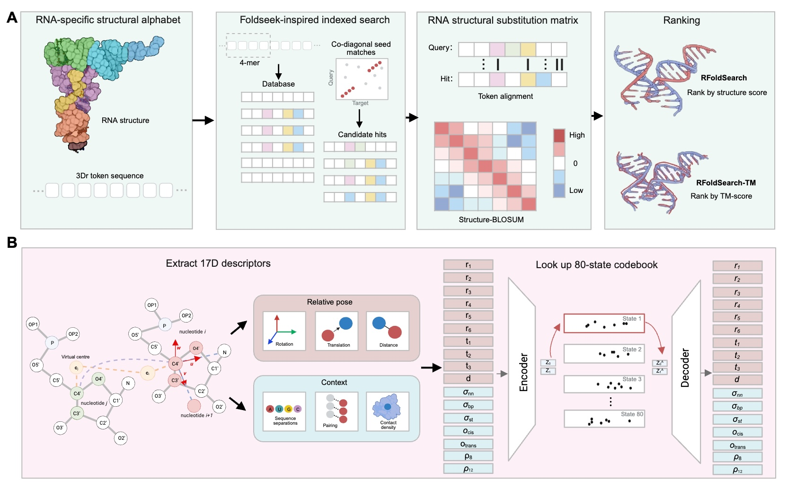

<h1><a name="rfoldsearch"></a></h1>

<p>
  <a href="LICENSE"></a>
  = 3.9" />
  <a href="#installation"></a>
</p>

RFoldSearch enables fast RNA tertiary-structure search with 3Dr, a learned discrete structural alphabet. Each nucleotide is described by a 17-D vector: the rigid-body transform to its nearest non-sequential spatial neighbour and its local context. A VQ-VAE quantises this vector into one of 80 states, converting RNA chains into token strings. Targets sharing at least two token k-mers on a common diagonal with the query pass the prefilter, and the top N are aligned by affine-gap token Smith-Waterman, which gives the alignment score and the nucleotide correspondence. For the default search mode, RFoldSearch estimates token-alignment E-values using a database-specific Gumbel model followed by calibration of unrelated background counts. Hits are ranked by a structure score that combines the token-alignment score with the structural similarity of the aligned nucleotides, independently of the reported E-value. RFoldSearch-TM instead ranks candidates by US-align TM-score and does not report token-alignment E-values.

<p align="center"></p>

## Table of Contents

- [RFoldSearch](#rfoldsearch)
  * [Installation](#installation)
  * [Hardware and memory requirements](#hardware-and-memory-requirements)
  * [Quick start](#quick-start)
    + [Preprocess structures](#preprocess-structures)
    + [Build a database](#build-a-database)
    + [Search](#search)
    + [E-values](#e-values)
      - [Calibrating your own database](#calibrating-your-own-database)
    + [Python API](#python-api)
      - [Tokenize a structure into 3Dr](#tokenize-a-structure-into-3dr)
      - [Search](#search-1)
  * [Third-party components](#third-party-components)
  * [License](#license)

## Installation

One command installs RFoldSearch together with CD-HIT-EST and US-align:

```
git clone https://github.com/DylanYang/RFoldSearch.git && cd RFoldSearch
conda env create -f environment.yml
conda activate rfoldsearch
```

Without conda, `pip install .` installs RFoldSearch alone. CD-HIT-EST and US-align must
then be installed separately and they are needed only for building clustered databases,
`--rerank tm` and E-value calibration (`rfoldsearch fit-experimental-evalues`,
`rfoldsearch fit-predicted-evalues`).

## Hardware and memory requirements

A single core CPU is sufficient. Tokenization uses the bundled VQ-VAE checkpoint on CPU by default 
and moves to CUDA automatically if a GPU is available.

## Quick start

### Preprocess structures

Convert the target `.pdb` / `.cif` files into a backbone-coordinate JSONL:

```
rfoldsearch preprocess \
  --pdb_dir target_structures/ \
  --output target_structures.jsonl
```

| Option      | Description                                            |
| ----------- | ------------------------------------------------------ |
| `--max_len` | Skip chains longer than this many nucleotides           |

### Build a database

Cluster the target sequences at 80% identity, then tokenize the JSONL and
write a searchable token database:

```
cd-hit-est -i target_sequences.fasta -o target_nr80 \
  -c 0.8 -n 5 -aS 0.8 -aL 0.8 -g 1

rfoldsearch build \
  --data target_structures.jsonl \
  --clusters target_nr80.clstr \
  --output target_db.pt
```

`cd-hit-est` comes with the conda environment; after a plain `pip install`,
build it once from source if your platform has no package for it:

```
curl -L -O https://github.com/weizhongli/cdhit/releases/download/V4.8.1/cd-hit-v4.8.1-2019-0228.tar.gz
tar xzf cd-hit-v4.8.1-2019-0228.tar.gz && cd cd-hit-v4.8.1-2019-0228 && make openmp=no
```

| Option         | Description                                                     |
| -------------- | --------------------------------------------------------------- |
| `--min_len`    | Skip chains shorter than this many valid residues. No limit by default; the paper's 885-chain corpus used `--min_len 20` |
| `--checkpoint` | VQ-VAE tokenizer to encode with (default: the bundled one)       |
| `--clusters`   | CD-HIT `.clstr` (or id/cluster TSV) grouping near-duplicate chains |

### Search

Search a chain that is already in the database against it:

```
rfoldsearch search --query target_chain_id --db target_db.pt --top_k 10
```

Or search a chain from a separate query database:

```
rfoldsearch search --query query_db.pt --query_id query_chain_id --db target_db.pt
```

Both commands run the same two-stage pipeline — a k-mer prefilter over the 3Dr tokens, 
then a reranking of the candidates. What differs is how the candidates are reranked, chosen with `--rerank`:

- **`tm_a`** (default): affine-gap token Smith-Waterman defines the alignment,
  aligned C4′ atoms are superposed, and candidates are ranked by
  **R<sub>str</sub> = S<sub>SW</sub> × TM<sub>a</sub>**. `TM_a` is the mean of
  query- and target-length-normalised TM terms for the fixed token alignment.
  The E-value is still calculated from `S_SW`, not from `R_str`.
- **`tm`** (RFoldSearch-TM): the candidate pool is handed to
  [US-align](https://github.com/pylelab/USalign) and ranked by the mean of its two length-normalised TM-scores. 
  This measures structural similarity directly instead of scoring a token alignment, at a large cost in speed.

```
rfoldsearch search --query target_chain_id --db target_db.pt --rerank tm
```

TM mode needs a `USalign` binary, which the conda environment installs. After
a plain `pip install`, build it once from source and either put it on your
`PATH`, set `$USALIGN`, or pass `--usalign`:

```
git clone https://github.com/pylelab/USalign && cd USalign && g++ -O3 -o USalign USalign.cpp
```

#### Output format

A comment line names the query, database, and ranking mode, followed by one
row per hit. Under the default mode, hits are ranked by `R_str`:

```
# query: query_chain_id  (128 tokens)   database: target_db.pt   rerank: R_str = S_SW x TM_a
rank  target                       R_str     TM_a      S_SW    E-value   aligned    len
   1  4V9F_A                       358.44   0.8700    412.00    2.1e-30       124    129
   2  6XU8_B                       221.38   0.7700    287.50    5.4e-19       111    121
   3  7QR4_A                       159.39   0.6900    231.00    8.8e-14       103    134
```

Under `--rerank tm` — RFoldSearch-TM — the comment line names the mode and the score columns change:

```
# query: query_chain_id  (74 tokens)   database: target_db.pt   rerank: RFoldSearch-TM
rank  target                    TM_mean  TM_query  TM_target    len
   1  PDB_00008B2L_1_W2          0.7076    0.7143     0.7008     76
   2  PDB_00008KD9_1_M           0.6724    0.6674     0.6773     72
   3  PDB_00008AW3_1_1           0.6688    0.6662     0.6715     73
```

#### Important search parameters

| Option       | Category    | Description                                                                        |
| ------------ | ----------- | ---------------------------------------------------------------------------------- |
| `--top_k`    | Output      | Number of top hits to return (default: 10)                                         |
| `--rerank`   | Scoring     | `tm_a` (default) or `tm`                                                           |
| `--top_n`    | Sensitivity | Candidate-pool depth passed to the reranker (default: 200) |
| `--min_diag` | Sensitivity | k-mer hits required on a common diagonal to admit a target (default: 2) |
| `--query_id` | Input       | Chain id to look up inside `--query` when it is a database file                    |
| `--model`    | Input       | VQ-VAE tokenizer for the query (default: the bundled one)                          |
| `--matrix`   | Scoring     | Substitution matrix (default: the bundled Structure-BLOSUM)                        |
| `--evalue_params` | Scoring | Database-specific E-value parameter file for this search |
| `--usalign`  | Scoring     | Path to the `USalign` binary, `--rerank tm` only (default: `$USALIGN`, then `PATH`) |

### E-values

An E-value is the number of unrelated database clusters (CD-HIT-EST, 80%
identity) expected to score at least as high as a hit by chance. Smaller
values mean the hit is less likely to be a chance match. E-values are
computed from the raw Smith--Waterman token-alignment score, with a
composition adjustment for predicted-structure databases (below). They are
reported in the default mode, and they do not measure the structure score
R<sub>str</sub> used for ranking.
RFoldSearch-TM (`--rerank tm`) aligns with US-align instead and reports no
E-values.

E-values are calibrated separately for each database. A statistical model of
chance scores, which accounts for query and target length, is fitted to
structurally unrelated database hits and then corrected so that the reported
values match the number of unrelated hits actually observed. RFoldSearch ships
parameters for the paper's experimental-structure database. Any other database
needs its own calibration. Without matching parameters, the search warns and
reports no E-values.

Predicted structures often contain long runs of a few repeated tokens, such as
helices, that align well to many unrelated chains. For predicted databases the
E-value therefore uses a composition-adjusted score: each query position is
scored relative to its surrounding ±20 tokens, so matches that its
neighbourhood would produce anyway count less. This adjustment affects only
the E-value. Hits are still ranked by the unadjusted score.

#### Calibrating your own database

Both fitting commands need an 80%-identity-clustered database and a TSV of
`chain_id`, `family` and `clan` (Rfam) for its chains.
`scripts/export_experimental_rfam_labels.py` exports these labels for PDB
chains, and `scripts/build_rfam_labels.py` builds them from `cmscan --fmt 2`
output.

Experimental structures:

```
rfoldsearch fit-experimental-evalues \
  --db target_nr80.pt --labels rfam_labels.tsv \
  --workdir fit --output evalues.json --usalign /path/to/USalign
```

Predicted structures:

```
rfoldsearch fit-predicted-evalues \
  --db target_nr80.pt --labels rfam_labels.tsv \
  --training-indices core.npy --auxiliary-indices auxiliary.npy \
  --calibration-indices calibration.npy \
  --workdir fit --output evalues.json --usalign /path/to/USalign
```

Then attach the parameters and search the new file as usual:

```
rfoldsearch attach-calibration --db target_nr80.pt \
  --clusters target_nr80.clstr --evalue_params evalues.json \
  --output target_calibrated.pt
```

Fitting audits high-scoring background hits with US-align and can take a
while. An interrupted fit resumes from `--workdir`, and precomputed scores or
TM-scores can be supplied to skip those steps (see `--help`).

### Python API

#### Tokenize a structure into 3Dr

The **3Dr** alphabet is built on: `encode_entry` turns one chain into a token per nucleotide, each an integer in `0..79`. 
There is no letter form — 80 states do not fit the Latin alphabet — so the tokens are an integer array, and a chain is a string over that alphabet.

```python
import torch
from rfoldsearch import structure_to_entry
from rfoldsearch.search import asset
from rfoldsearch.tokenizer import encode_entry, load_model

model, ckpt, n_codes, _ = load_model(asset("desc_vqvae_best.pt"))   # or your own
enc = encode_entry(model, structure_to_entry("query.cif"), torch.device("cpu"),
                   ckpt.get("norm_mean"), ckpt.get("norm_std"),
                   active_blocks=ckpt.get("active_blocks"))

enc["tokens"]     # int16, one 3Dr state per resolved nucleotide, e.g. [22, 53, 53, 44, …]
enc["n_valid"]    # how many nucleotides were resolved well enough to tokenize
enc["coords"]     # (n_valid, 5, 3) backbone coordinates, kept for US-align
```

`encode_entry` returns `None` when a chain has no resolved nucleotides at all,
or when its edge arrays disagree with its mask; there is no minimum length here,
`--min_len` is applied by `rfoldsearch build`. `structure_to_entry` reads both
`.cif` and `.pdb`, and `load_model` puts the model on whatever device you pass,
so `torch.device("cuda")` runs the tokenizer on a GPU.

#### Search

A query already in the database needs no tokenizer, since the database holds its tokens:

```python
from rfoldsearch import Searcher

s = Searcher("target_db.pt")
hits = s.search_id("target_chain_id", top_k=10)
# [{'rank': 1, 'target': …, 'structure_score': …, 'tm_a': …,
#   'aligned': …, 'sw_score': …, 'bits': …, 'evalue': …}, …]
```

Anything else is searched by handing `search` the tokens from above:

```python
import numpy as np

hits = s.search(np.asarray(enc["tokens"], np.int64), query_entry=enc, top_k=10)
```

`query_entry` is required by both `rerank="tm_a"` (default) and `rerank="tm"`,
because both use query coordinates.
`search_id` forwards its keyword arguments to `search`, so `top_n`, `min_diag`, `rerank`
and `tie_seed` are available from both. `bits` and `evalue` are present when
E-value parameters matching the database are loaded (by default, only for the
paper's database).

`Searcher` deliberately takes no tokenizer — searching happens on tokens, not
structures. It does accept the two files that interpret those tokens,
`Searcher(db, matrix_path=…, evalue_params_path=…)`, which is how to search
under a different Structure-BLOSUM matrix or a calibration of your own. On the
command line, the corresponding options are `--model`, `--matrix`,
`--checkpoint`, and `--evalue_params`.

## Third-party components

No third-party source is vendored. Runtime dependencies are `numpy`, `torch`, `numba`, `biotite` and `scipy`,
each under its own license. `--rerank tm` calls US-align (Zhang et al., *Nat. Methods* 2022) as an external
program, and `--clusters` consumes the output of CD-HIT-EST (Fu et al.,
*Bioinformatics* 2012). Neither source is vendored; both are installed from
bioconda by `environment.yml`, and after a plain `pip install` users supply
their own binaries.

## License

Apache License 2.0. See [LICENSE](LICENSE).
