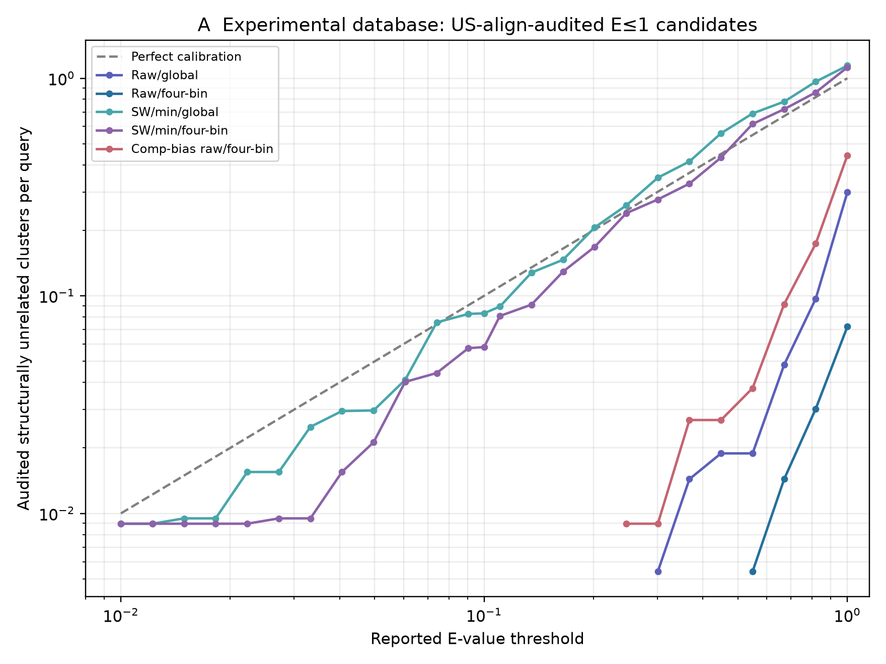
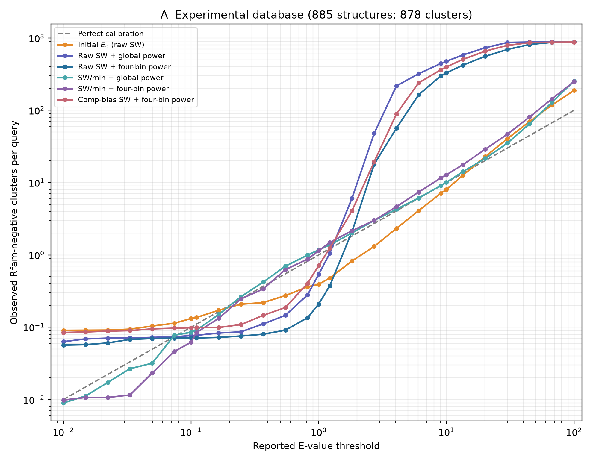

# RFoldSeek experimental E-value methods: fresh matched comparison

**Status: exploratory, not a publication-ready Fig. S16A.** All score arrays, tokens,
clusters and model coefficients in this run were recomputed from the 885 mmCIF
files. Operational E≤1 negatives were structurally audited, but exclusions
have not yet been fed back into parameter fitting; numbers labelled
Rfam-negative remain a *proxy* for unrelated backgrounds, not certified false
positives. No prior score/parameter/result cache was used.

## Executive summary

- In a fresh 885-chain/878-cluster database, raw SW discriminated same-family from annotated negatives better than SW/min (family-macro AUC 0.892 vs 0.811).
- At reported E≤1, US-align-confirmed homolog-cluster recall was 0.512 for raw/global, 0.434 for raw/four-bin, 0.246 for SW/min/global, and 0.515 for composition-corrected raw/four-bin.
- Audited unrelated clusters per query at reported E=1 were 0.299, 0.072, 1.142, and 0.442 in the same order (ideal: 1).
- This is a matched candidate comparison, not a deployment decision:
  structurally related clusters must be removed and backfilled before
  Gumbel and power refitting, then the full evaluation repeated.

## Data and reproducibility

- Source: 885 mmCIF files; successfully extracted 885; failed 0. Multi-chain files were restricted to the chain ID in the filename.
- Fresh CD-HIT-EST clustering: 80% identity, `-c 0.8 -n 5 -aS 0.8 -aL 0.8 -g 1`; 878 clusters.
- 516 Rfam-annotated calibration queries; 75 auxiliary queries (38 shortest and 37 lowest-token-entropy unannotated chains) used only in Gumbel training (20% total likelihood weight).
- 468 annotated queries have at least one non-self same-family cluster and enter homolog-recovery metrics.
- Database: generated `db_nr80.pt` (`1e5c41378043e07479bba90045dc08d62265248dce3ced11ac412b14f368e2eb`).
- Rfam labels: input `labels.tsv` (`829a7369b70fd5f7a0d15e2ca729e37ec503efde8798ee74102ab6a14b40a9f6`).
- Score matrix: `adb51e94666b085c492150eeda6878c0fb1a3bdb85cc12088b66b2b3ac6ece37`; score arrays and query order are recorded in `score_manifest.json`.
- Software environment: Python 3.12.14, NumPy 2.5.3, SciPy 1.18.1,
  PyTorch 2.14.1+cpu, Numba 0.68.0, Biotite 1.7.1, CD-HIT-EST 4.8.1.
- Verification: four new unit tests passed; `qa_checks.json` passed
  finite-score, fold-blocking, convergence, four-bin and monotonicity checks.
- Four folds are blocked jointly by Rfam family and clan; in each rotation,
  the three non-test folds supply cross-fitted E0 values for power fitting,
  and the untouched fold tests both Gumbel and power. All three training
  folds fit the test-fold Gumbel model.
  All candidates share the same fold assignments, targets and exclusion rules.

## Candidate methods

Raw SW and SW/min use the same token Smith–Waterman alignment (gap open −2,
extend −0.5). The composition-bias candidates recalculate the alignment
with a window-20 query profile; normalization, where used, divides the
result by min(query length, target length). For all score variants, a
target-aware linear model predicts Gumbel location and log-scale from query
length, cluster median length, absolute log-length difference, and query
token entropy. No three-fold query–target length filter is applied to
fitting, calibration or E0 summation. By default, fitting is left-censored below the 95th
percentile in shorter-length/length-ratio strata. E0 sums Gumbel survival
over all target clusters. Global power fits one a,b; four-bin power fits
one shared b and four length-conditional a values (bins merge if unsupported).
This is a matched four-bin **analogue**, not a byte-for-byte run of PR #27:
the collaborator's 198-query inputs and complete fitting configuration
were unavailable, so PR percentages are shown separately below.
For the experimental annotated background, each query's count is expanded
by N_D/B_q. The fitted range is E0≤100; above it Ecal grows proportionally
from the endpoint and is capped at the cluster count.

In notation, for each score variant $s_{qj}$, the non-self, non-family,
non-clan cluster maximum is $Y_{qc}=\max_{j\in\mathcal M_{qc}}s_{qj}$.
The shared conditional null has
$(\mu_{qc},\log\beta_{qc})=[1,z(\log L_q),z(\log L_c),
z(|\log L_q-\log L_c|),z(H_q)]\Theta_D$ and
$E_0(q,s)=\sum_c[1-F_{qc}(s)]$. The final mapping is
$E_{\mathrm{cal}}=a_D(L_q)E_0^{b_D}$, with constant $a_D$ for the
global candidate or interpolated length-bin $a_D(L_q)$ for the four-bin
candidate. The score mode changes $s_{qj}$, not these covariates.
Each $z$ uses the weighted mean and standard deviation of eligible
Gumbel-training cluster observations within that fold; these values
are stored with the model and reused without restandardizing test queries.

## Matched held-out results

| Method | AUC [95% CI] | Homolog clusters E≤0.01 | E≤0.1 | E≤1 | Queries ≥1 homolog E≤1 | Background E≤1/q [95% CI] | Log10 calibration RMSE | Self max E |
|---|---:|---:|---:|---:|---:|---:|---:|---:|
| Raw SW + global power | 0.892 [0.847, 0.930] | 0.106 [0.045, 0.178] | 0.174 [0.094, 0.260] | 0.415 [0.304, 0.521] | 0.570 [0.447, 0.685] | 0.539 [0.254, 0.917] | 1.004 | 0.869 |
| Raw SW + four-bin power | 0.892 [0.847, 0.930] | 0.101 [0.041, 0.171] | 0.152 [0.073, 0.237] | 0.342 [0.240, 0.447] | 0.495 [0.378, 0.611] | 0.209 [0.0873, 0.357] | 0.914 | 0.833 |
| SW/min + global power | 0.811 [0.749, 0.867] | 0.058 [0.011, 0.121] | 0.092 [0.031, 0.168] | 0.194 [0.113, 0.283] | 0.366 [0.251, 0.471] | 1.17 [0.925, 1.44] | 0.122 | 0.012 |
| SW/min + four-bin power | 0.811 [0.749, 0.867] | 0.056 [0.009, 0.119] | 0.091 [0.036, 0.160] | 0.194 [0.114, 0.282] | 0.364 [0.250, 0.467] | 1.14 [0.905, 1.38] | 0.194 | 0.00788 |
| Comp-bias SW + global power | 0.884 [0.837, 0.922] | 0.135 [0.062, 0.219] | 0.208 [0.124, 0.303] | 0.397 [0.291, 0.502] | 0.561 [0.443, 0.671] | 0.379 [0.177, 0.668] | 0.942 | 0.646 |
| Comp-bias SW + four-bin power | 0.884 [0.837, 0.922] | 0.129 [0.059, 0.212] | 0.203 [0.120, 0.294] | 0.414 [0.303, 0.522] | 0.573 [0.455, 0.686] | 0.714 [0.276, 1.28] | 0.936 | 0.455 |
| Comp-bias SW/min + global power | 0.793 [0.726, 0.852] | 0.047 [0.011, 0.098] | 0.074 [0.025, 0.140] | 0.194 [0.108, 0.287] | 0.351 [0.236, 0.459] | 0.916 [0.661, 1.19] | 0.141 | 0.00654 |
| Comp-bias SW/min + four-bin power | 0.793 [0.726, 0.852] | 0.036 [0.008, 0.083] | 0.069 [0.021, 0.134] | 0.143 [0.075, 0.221] | 0.292 [0.185, 0.391] | 0.657 [0.465, 0.876] | 0.135 | 0.00776 |

## Interim interpretation for method selection

- Raw SW discriminates same-family from annotated negatives better than SW/min (family-macro AUC 0.892 versus 0.811); its global-power homolog recall at E≤1 is 0.415 versus 0.194.
- After structural adjudication, the observed unrelated-cluster count at reported E=1 is 0.299 for raw/global, 0.072 for raw/four-bin, and 1.142 for SW/min/global. The raw candidates are conservative under the current fits; the normalized candidate is closer to the nominal count.
- Among US-align-confirmed same-family homolog clusters, E≤1 recall is 0.512 for raw/global, 0.434 for raw/four-bin, 0.246 for SW/min/global, and 0.515 for composition-corrected raw/four-bin.
- Four length bins do not yield a clear gain over one global power
  correction in this nested 516-query comparison. All four bins were
  present in every held-out fold after the fitting-design correction,
  so this is not an artifact of silently collapsed bins.
- The 20-token composition correction is a plausible additional
  candidate, but it does not yet resolve the sensitivity–calibration
  tradeoff decisively. The primary unresolved step is to exclude
  structurally related background **before refitting** Gumbel and power.

The AUC compares, within a query, a same-family target-cluster maximum
against Rfam-negative annotated clusters. Homolog recovery is the
family-macro mean of per-query positive-cluster recovery among queries
with an available non-self homolog. The 'queries ≥1 homolog' metric uses
the same evaluable-query denominator. Background E≤1/q is the
family-balanced, N_D/B_q-expanded Rfam-negative count; if all biological
negatives were correctly classified, perfect calibration would be 1.
Confidence intervals resample Rfam families as blocks (2,000 replicates).
Log10 calibration RMSE uses positive observed points on the common
threshold grid; zeros are omitted, not silently replaced by a floor.

### Background calibration at operational thresholds

| Method | Observed at reported E=0.01 [95% CI] | At E=0.1 | At E=1 |
|---|---:|---:|---:|
| Raw SW + global power | 0.0631 [0.013, 0.129] | 0.0766 [0.0173, 0.151] | 0.539 [0.254, 0.917] |
| Raw SW + four-bin power | 0.0566 [0.0118, 0.118] | 0.071 [0.0171, 0.143] | 0.209 [0.0873, 0.357] |
| SW/min + global power | 0.00897 [0, 0.0269] | 0.0852 [0.0391, 0.144] | 1.17 [0.925, 1.44] |
| SW/min + four-bin power | 0.00983 [0, 0.0295] | 0.062 [0.0289, 0.105] | 1.14 [0.905, 1.38] |
| Comp-bias SW + four-bin power | 0.0846 [0.019, 0.162] | 0.0985 [0.0197, 0.182] | 0.714 [0.276, 1.28] |

A perfectly calibrated method has expected values 0.01, 0.1, and 1
in these three columns. All values here still include any unreviewed
structural relatives among Rfam-negative hits.

### US-align-audited operational false-positive proxy (E≤1)

27,942 unique query–target pairs received a
fresh US-align adjudication. The table below is reported only for
methods whose complete Rfam-negative candidate set at E≤1 was
audited; all same-family candidates were also audited.
Pairs with mean query-/target-normalized TM-score
below 0.45 count as *operationally unrelated*, not proof of no homology.
When zero events are observed, family-block bootstrap cannot
estimate a nonzero upper confidence bound; such cells are marked
'no observed events' rather than presenting a misleading [0,0] CI.

| Method | Unrelated clusters/q at E=0.01 [95% CI] | E=0.1 | E=1 | Queries with ≥1 unrelated hit at E≤1 |
|---|---:|---:|---:|---:|
| Raw/global | 0 [no observed events] | 0 [no observed events] | 0.299 [0.124, 0.525] | 0.091 [0.043, 0.149] |
| Raw/four-bin | 0 [no observed events] | 0 [no observed events] | 0.0721 [0.0165, 0.147] | 0.034 [0.009, 0.065] |
| SW/min/global | 0.00897 [0, 0.0269] | 0.0831 [0.0365, 0.142] | 1.14 [0.905, 1.4] | 0.439 [0.357, 0.522] |
| SW/min/four-bin | 0.00897 [0, 0.0269] | 0.0582 [0.0249, 0.0997] | 1.12 [0.887, 1.36] | 0.455 [0.370, 0.536] |
| Comp-bias raw/four-bin | 0 [no observed events] | 0 [no observed events] | 0.442 [0.111, 0.947] | 0.078 [0.037, 0.128] |

The US-align screen used the exact mode for initial pairs and
`-fast` for computationally costly later pairs; fast scores within
0.05 of TM=0.45 are rechecked with the exact mode where available.
Crucially, these adjudications have **not yet been fed back into**
Gumbel or power refitting. Thus, this is an external diagnostic of
the current fits, not their final structurally filtered calibration.

### US-align-audited structurally similar homolog recovery

The denominators comprise all non-self, same-Rfam-family target
clusters with a successful US-align assessment and mean TM-score
at least 0.45. Percentages are family-macro averages of per-query
cluster recall; the last column is the fraction of evaluable
queries with at least one such hit. Family-block 95% bootstrap
intervals are shown. These metrics were computed only after the
complete same-family candidate set was audited.

| Method | Evaluable queries | Homolog clusters E≤0.01 [95% CI] | E≤0.1 | E≤1 | Queries ≥1 homolog E≤1 |
|---|---:|---:|---:|---:|---:|
| Raw/global | 435 | 0.133 [0.059, 0.219] | 0.215 [0.116, 0.323] | 0.512 [0.386, 0.630] | 0.638 [0.509, 0.760] |
| Raw/four-bin | 435 | 0.126 [0.055, 0.209] | 0.183 [0.094, 0.288] | 0.434 [0.315, 0.553] | 0.568 [0.441, 0.692] |
| SW/min/global | 435 | 0.083 [0.022, 0.161] | 0.122 [0.050, 0.206] | 0.246 [0.153, 0.345] | 0.417 [0.297, 0.536] |
| SW/min/four-bin | 435 | 0.081 [0.020, 0.158] | 0.120 [0.052, 0.202] | 0.236 [0.145, 0.336] | 0.411 [0.294, 0.534] |
| Comp-bias raw/four-bin | 435 | 0.160 [0.075, 0.260] | 0.274 [0.174, 0.389] | 0.515 [0.389, 0.636] | 0.648 [0.518, 0.770] |

### Collaborator-provided PR #27 snapshot (reference only)

The screenshot supplied with this request for
[PR #27](https://github.com/DylanYang/RFoldSearch/pull/27) reports the following
on a
different 198-query panel. These are **not** merged with, or directly
subtracted from, the fresh 516-query estimates above:

| PR snapshot method | E≤0.01 | E≤0.1 | E≤1 | Structurally similar homolog E≤1 | Query ≥1 homolog E≤1 |
|---|---:|---:|---:|---:|---:|
| SW/min | 9% | 18% | 33% | 41% | 69% |
| Raw SW, global | 56% | 62% | 67% | 82% | 84% |
| Raw SW, four bins | 62% | 68% | 72% | 88% | 84% |

The present comparison recomputes the same *types* of sensitivity
metrics, but its null model, query panel, fold split and structural-audit
status differ. Agreement in direction is informative; numerical equality
is not expected. In particular, the 198 query IDs and their selection
manifest were not available as raw inputs here; no claim of exact PR
replication is made.

### Paired family-blocked method contrasts

| Contrast (left − right) | AUC difference [95% CI] | Homolog recall E≤0.01 difference | E≤1 difference |
|---|---:|---:|---:|
| Raw/global − SW/min/global | +0.081 [+0.041, +0.127] | +0.048 [-0.024, +0.116] | +0.221 [+0.137, +0.315] |
| Raw/four-bin − raw/global | +0.000 [+0.000, +0.000] | -0.005 [-0.010, -0.001] | -0.073 [-0.110, -0.040] |
| Comp-bias raw/four-bin − raw/four-bin | -0.008 [-0.027, +0.010] | +0.028 [+0.009, +0.056] | +0.072 [+0.033, +0.117] |

These CIs resample the same Rfam families across methods, retaining the
within-query pairing. They quantify discrimination/sensitivity changes,
not whether either E-value method is well calibrated.

| Contrast | Clan-block AUC difference 95% CI | Clan-block E≤1 homolog-recall difference 95% CI | Independent blocks |
|---|---:|---:|---:|
| Raw/global − SW/min/global | [+0.023, +0.130] | [+0.106, +0.341] | 33 |
| Raw/four-bin − raw/global | [+0.000, +0.000] | [-0.111, -0.039] | 33 |
| Comp-bias raw/four-bin − raw/four-bin | [-0.025, +0.012] | [+0.036, +0.121] | 33 |

Clan-block resampling is a dependence-robust sensitivity analysis of
the same paired family-macro contrast; linked families are sampled
together rather than treated as independent blocks.

### Stratified background calibration at reported E=1

| Method | Query length (nt) | Queries | Observed Rfam-negative clusters/q |
|---|---:|---:|---:|
| Raw/global | 30–59 | 43 | 0.0716 |
| Raw/global | 60–119 | 228 | 0.448 |
| Raw/global | <30 | 5 | 0 |
| Raw/global | ≥120 | 240 | 1.23 |
| Raw/four-bin | 30–59 | 43 | 0.144 |
| Raw/four-bin | 60–119 | 228 | 0.0249 |
| Raw/four-bin | <30 | 5 | 0 |
| Raw/four-bin | ≥120 | 240 | 0.596 |
| SW/min/global | 30–59 | 43 | 0.412 |
| SW/min/global | 60–119 | 228 | 1.54 |
| SW/min/global | <30 | 5 | 5.95 |
| SW/min/global | ≥120 | 240 | 1.33 |

| Method | Query token entropy quartile | Queries | Observed Rfam-negative clusters/q |
|---|---:|---:|---:|
| Raw/global | Q1 | 129 | 0.579 |
| Raw/global | Q2 | 129 | 0.431 |
| Raw/global | Q3 | 129 | 0.969 |
| Raw/global | Q4 | 129 | 1.76 |
| Raw/four-bin | Q1 | 129 | 0.105 |
| Raw/four-bin | Q2 | 129 | 0.105 |
| Raw/four-bin | Q3 | 129 | 0.472 |
| Raw/four-bin | Q4 | 129 | 1.66 |
| SW/min/global | Q1 | 129 | 1.09 |
| SW/min/global | Q2 | 129 | 1.47 |
| SW/min/global | Q3 | 129 | 1.27 |
| SW/min/global | Q4 | 129 | 1.06 |

These are within-stratum family-macro means, not a claim that all strata
are calibrated by a single pooled power fit.

### Final all-query fit parameters and self-search diagnostic

| Score mode | Global a | Global b | Four-bin shared b | Supported bins | Tail maxima used | Max Gumbel gradient |
|---|---:|---:|---:|---:|---:|---:|
| raw | 1.143 | 0.2379 | 0.2379 | 4 | 21,332 | 8e-07 |
| normalized | 0.05812 | 1.359 | 1.359 | 4 | 24,215 | 1.3e-05 |
| compbias_raw | 1.549 | 0.2333 | 0.2333 | 4 | 28,645 | 5.5e-07 |
| compbias_normalized | 0.2212 | 1.071 | 1.071 | 4 | 27,856 | 1.7e-05 |

The full 2×5 conditional Gumbel coefficient matrices, feature means and
scales, and each length-bin intercept are serialized in the locally generated `comparison.json` (not bundled here).
These are **research fits**, not deployment parameters.

| Mode/calibration | Self E min | Median | 95th percentile | Max | E>1 | Max-E chain |
|---|---:|---:|---:|---:|---:|---|
| raw/global | 2.64e-36 | 0.000155 | 0.172 | 0.869 | 0/885 | PDB_00004JGN_1_E (20 nt) |
| raw/four_bin | 2.08e-35 | 0.000237 | 0.165 | 0.833 | 0/885 | PDB_00004JGN_1_E (20 nt) |
| normalized/global | 1.27e-16 | 1.6e-10 | 1.11e-05 | 0.012 | 0/885 | PDB_00004JGN_1_E (20 nt) |
| normalized/four_bin | 8.87e-17 | 1.41e-10 | 7.8e-06 | 0.00788 | 0/885 | PDB_00004JGN_1_E (20 nt) |
| compbias_raw/global | 1.82e-71 | 4.82e-06 | 0.032 | 0.646 | 0/885 | PDB_00004JGN_1_E (20 nt) |
| compbias_raw/four_bin | 1.4e-70 | 3.97e-06 | 0.0226 | 0.455 | 0/885 | PDB_00004JGN_1_E (20 nt) |
| compbias_normalized/global | 6.44e-14 | 3.45e-11 | 1.57e-07 | 0.00654 | 0/885 | PDB_00004JGN_1_E (20 nt) |
| compbias_normalized/four_bin | 8.73e-14 | 4.58e-11 | 2.41e-07 | 0.00776 | 0/885 | PDB_00004JGN_1_E (20 nt) |

## Important limitations and next validation gate

1. US-align structural adjudication has **not yet been fed back into**
   background selection or model fitting. A candidate audit list is saved
   as `structural_audit_candidates.tsv`. Until audited and refitted to a
   fixed point, definitive E-value calibration and publication Fig. S16A
   cannot be claimed from this run. Structural-homolog recovery is an
   external diagnostic only after the complete positive audit is available.
   A structurally excluded cluster leader must also be replaced by its
   next eligible member during the eventual refit (cluster backfill).
2. Rfam absence does not prove biological unrelatedness. The background
   table is a conservative annotation-based proxy, not specificity ground truth.
   The local 885-CIF selection and Rfam labels were treated as frozen raw
   inputs; their original external acquisition/annotation was not repeated.
3. The 75 auxiliary queries are unannotated and may contain unknown
   structural relatives; they are downweighted but should be reviewed.
4. The collaborator's PR #27 198-query panel is a distinct cohort; its
   published-in-PR percentages must not be pooled with these 516-query
   estimates. This comparison addresses AUC, homolog recovery,
   length-binned power and background-calibration metrics under
   a fresh, matched protocol.
5. Self-hit E-values come from an all-query final refit and are a
   diagnostic, not held-out calibration evidence. Very small values below
   the fitted power support are extrapolations, not precisely validated p-values.

**Decision rule:** Do not select a deployment method solely by the smallest
self-hit E-value or highest homolog recall. Require family-blocked
calibration (observed/expected near one with uncertainty), a manageable
audited false-positive burden, useful homolog sensitivity, and stability
across query length/entropy strata before updating the manuscript or server.

## Related code and outputs

- `scripts/fresh_experimental_evalue_preprocess.py`
- `scripts/fresh_experimental_evalue_scores.py`
- `scripts/fresh_experimental_evalue_compare.py`
- `scripts/audit_clean_experimental_background.py` (optional complete member-level audit for a separate cleaned refit)
- `scripts/fresh_experimental_evalue_usalign.py`, `scripts/recheck_fresh_usalign_boundary.py`, `scripts/summarize_fresh_evalue_usalign.py`
- `scripts/check_fresh_experimental_evalue_run.py`, `scripts/write_fresh_experimental_evalue_report.py`, `tests/test_fresh_experimental_evalue_compare.py`
- `comparison.json` (generated locally; not bundled; all fold and final coefficients, curves and metrics)
- `cv_folds.tsv` (bundled); `per_query_*.jsonl` and `structural_audit_candidates.tsv` (generated locally; not bundled)
- `qa_checks.json` (finite scores, convergence, blocked folds, four-bin support, monotonicity)
- `panel_A_candidate_comparison.png` and `panel_A_audited_E_le_1.png`

Reference for collaborator-proposed alternatives: [RFoldSearch PR #27](https://github.com/DylanYang/RFoldSearch/pull/27).
